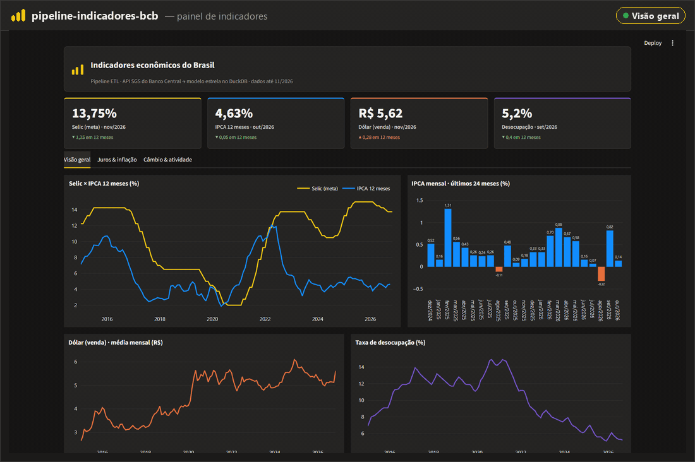
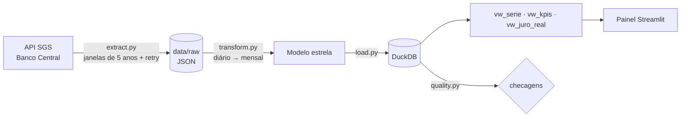

# 📊 Pipeline de indicadores econômicos · BCB → DuckDB → painel

Pipeline de dados de ponta a ponta: extrai séries oficiais da **API SGS do Banco Central**, transforma em um
**modelo estrela mensal**, carrega no **DuckDB** com views analíticas, valida a qualidade e alimenta um
**painel no estilo Power BI** em Streamlit + Plotly.

<p align="center">
  
</p>

## Arquitetura



| Camada | O que faz |
|---|---|
| **Extração** | 6 séries (Selic, IPCA mensal e 12 meses, dólar, desocupação, IBC-Br) desde 2015, em janelas de 5 anos porque a API limita séries diárias; retry com backoff exponencial. |
| **Transformação** | Séries diárias viram mensais (Selic: valor de fim de mês; dólar: média). Gera `dim_tempo`, `dim_indicador` e `fato_indicador_mensal`. |
| **Carga** | DuckDB com chaves primárias e views: `vw_serie` (fato + dimensões), `vw_kpis` (último valor e variação em 12 meses, com window function) e `vw_juro_real` (Selic − IPCA 12m). |
| **Qualidade** | Nulos, chave duplicada, integridade referencial (ANTI JOIN), histórico mínimo e defasagem de cada série. A execução falha se algo quebrar. |
| **Painel** | Cartões de KPI e 3 páginas: visão geral, juros & inflação, câmbio & atividade. |

```text
23:45:51 INFO    extração · 6 séries do SGS/BCB
23:46:10 INFO      fato_indicador_mensal     852 linhas
23:46:10 INFO    fim em 19.0 s · OK
```

## Rodando

```bash
pip install -r requirements.txt
python run.py            # extrai, transforma, carrega e valida
streamlit run app.py     # abre o painel
pytest -q                # testes de transformação, carga e qualidade
```

O workflow `.github/workflows/pipeline.yml` roda os testes e o pipeline todo dia 5 e publica o banco como artefato.

## Stack

Python · pandas · DuckDB · SQL (window functions, views) · Streamlit · Plotly · pytest · GitHub Actions
